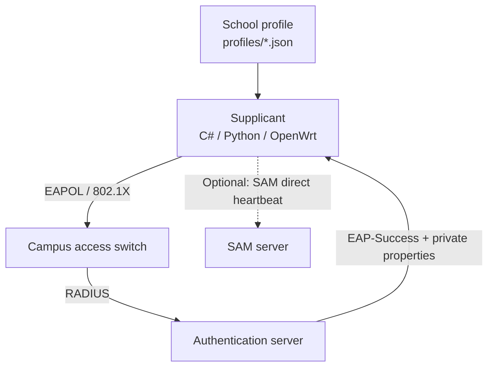

<div align="center">
  <h1>RuijieCampusAuth</h1>
  <p><strong>A cross-platform, third-party implementation of Ruijie campus 802.1X authentication</strong></p>
  <p>Protocol research → verifiable implementation → deployable clients for Windows / Linux / OpenWrt</p>
  <p>
    
    
    
    
    
    
    
  </p>
</div>

<p align="center">
  🇨🇳 <a href="./README.md">简体中文</a> ·
  🇨🇳 <a href="./README.zh-TW.md">繁體中文</a> ·
  🇺🇸 <a href="./README.en.md">English</a>
</p>

## Table of Contents

- [Project Overview](#project-overview)
- [Highlights](#highlights)
- [Quick Start](#quick-start)
- [How It Works](#how-it-works)
- [Protocol Coverage](#protocol-coverage)
- [Implementation Matrix](#implementation-matrix)
- [Build and Run](#build-and-run)
- [Configuration and Data](#configuration-and-data)
- [Verification](#verification)
- [Repository Layout](#repository-layout)
- [Documentation](#documentation)
- [Scope and Compliance](#scope-and-compliance)
- [Contributing](#contributing)
- [License](#license)

## Project Overview

RuijieCampusAuth is a third-party, open-source implementation of the 802.1X authentication protocol used by Ruijie campus networks. It models the protocol behaviour of Ruijie's official Windows client, `8021x.exe`, and provides three implementations that share the same protocol semantics and configuration model:

| Form | Stack | Platforms | Interface |
|---|---|---|---|
| C# reference | C# / .NET 10 · Npcap · `SslStream` | Windows | Avalonia GUI, Windows service, CLI |
| Python reference | Python 3.10+ · scapy · `ssl` + `MemoryBIO` | Windows / Linux / macOS | Numeric menu, argparse CLI |
| OpenWrt | Go 1.25 · AF_PACKET · `crypto/tls` | OpenWrt 24.10 (same-arch devices; R3G is the test vehicle) | LuCI, 8 pages |

The design principles are **protocol compatibility, verifiable behaviour, and externalised school configuration**. The project does not modify server behaviour, bypass the authentication flow, or compile school codes, service names, static IDs, or service addresses into the binary. School differences are injected through `profiles/*.json`; the software itself contains no hard-coded school parameters.

The OpenWrt form is not limited to the R3G. The prebuilt ipk is a pure-userland static Go binary that only requires a same-architecture OpenWrt of a similar version; the R3G is the primary test vehicle and the first model we provide custom firmware for. Other soft routers can install the same-architecture ipk directly, and more model-specific firmware will follow.

The project covers the authentication protocol and the operational surface around it. It does not reproduce non-protocol components of the official client such as skins, pop-ups, announcements, tray apps, or installers, and it embeds no school accounts, passwords, or login credentials.

**Keywords**: IEEE 802.1X · EAP-MD5 · PEAP · MSCHAPv2 · EAPOL · Ruijie private protocol · OpenWrt · protocol interoperability

> [!IMPORTANT]
> This project is intended for protocol interoperability research and legitimate network access. Before use, confirm that you are authorised to access the target campus network and comply with your institution's network policies. The project does not provide the ability to bypass authentication, forge identities, or evade auditing.

### Versions and Releases

| Component | Version | Distribution |
|---|---|---|
| C# client | 1.0.0 | `RuijieCampusAuth-1.0.0-win-x64.zip`, self-contained .NET 10 |
| OpenWrt firmware / plugin | 0.11.5 | Same-architecture `ruijie-auth_0.11.5_mipsel_24kc.ipk` + R3G custom firmware (test vehicle) |
| Python reference | Source tree | `pip install -e python` |

See [Releases](https://github.com/FairyXH/RuijieCampusAuth/releases/latest) for the latest build.

## Highlights

- **Protocol core**: EAPOL framing, EAP-MD5, the 569-byte private tail, segmented server private properties, PEAP v0/v1 + MSCHAPv2, and EAP-TLS.
- **Multiple deployment forms**: Avalonia GUI, Windows service, and CLI on Windows; a cross-platform Python reference; a Go daemon with LuCI on OpenWrt.
- **Multi-school adaptation**: authentication method, service name, static ID, portal/self-service/upgrade endpoints, and DHCP mode all come from JSON profiles. Importing a profile only overwrites the fields it declares.
- **Verifiable implementation**: Unicorn calls into the original binary's algorithm functions for byte-for-byte differential testing; real server-accepted captures validate the 569-byte tails and private properties.
- **Operational surface**: account pool, server learning and locking, guardian/preemption, re-authentication scheduling, DHCP renew/release, portal, diagnostics, client takeover, and a debug pipe.
- **OpenWrt-friendly**: the supplicant itself is pure userland and depends only on AF_PACKET and the Go standard library. The ipk is not tied to the R3G and runs on same-architecture OpenWrt of a similar version. The R3G is the current test vehicle and the first model we provide custom firmware for; the WAN interface can be auto-detected or selected manually, and more model-specific firmware will follow.

## Quick Start

| Scenario | Recommended entry point |
|---|---|
| Windows desktop | Download `RuijieCampusAuth-1.0.0-win-x64.zip`, unzip, and run the GUI; requires Npcap and administrator rights |
| Protocol research / scripting | `cd python && pip install -e . && python -m ruijie_auth` |
| OpenWrt router | Install the same-architecture `ruijie-auth_0.11.5_mipsel_24kc.ipk`; R3G users can flash the full firmware |

> [!NOTE]
> Layer-2 packet I/O on Windows requires Npcap. Enabling WinPcap compatibility mode during installation is recommended. The GUI and the service both need administrator rights to open adapters and change network settings.

### 1. Windows (C#)

1. Download `RuijieCampusAuth-1.0.0-win-x64.zip` from [Releases](https://github.com/FairyXH/RuijieCampusAuth/releases/latest).
2. Extract it to a stable directory and run `RuijieCampusAuth.App.exe`.
3. Import a school profile on the "Config" page, add an account on the "Accounts" page, then start authentication.
4. To run at boot, install and start the Windows service from the "Service" page.

> [!NOTE]
> The current GUI and LuCI are Simplified Chinese only; the page names above reflect the actual UI.

### 2. Python

```bash
cd python
python -m pip install -e .
python -m ruijie_auth          # numeric menu
ruijie-auth --help             # argparse subcommands
```

The Python implementation is aimed at protocol research, scripting, and embedded scenarios. Layer-2 I/O requires Npcap (Windows) or libpcap (Linux/macOS) with the appropriate privileges.

### 3. OpenWrt

```sh
# Install the standalone plugin on the router (keeps existing config)
opkg install --force-reinstall /tmp/ruijie-auth_0.11.5_mipsel_24kc.ipk

# Import a school profile
ruijie-auth profile import --file "/etc/ruijie-auth/profiles/<school>.json"

# Check status
ruijie-auth status
```

The LuCI entry is **Services → Ruijie Auth**. `/etc/config/ruijie-auth` is a conffile, so upgrading the plugin preserves accounts, settings, and imported profiles.

## How It Works



<!-- Experimental: if rendering fails, preview this README on GitHub. -->

The client sends EAPOL-Start and EAP-Identity at layer 2, then completes EAP-MD5 or a PEAP/EAP-TLS handshake as requested by the server. Ruijie's private behaviour lives mainly in two places:

1. **569-byte private tail**: appended beyond the EAPOL length field. It carries a private header, CRC16/XMODEM, per-byte bit-reversal obfuscation, an attribute set, and MD5-chained credential encryption.
2. **Server private properties**: carried in EAP-Success as a segmented structure with a GBK message segment, a `0x6F` fixed block, version gates, a 15-byte de-obfuscation segment, a TLV loop, and RC4 fields.

After a successful authentication, if the server delivers a SAM address and `ENCRYPT_KEY`/`ENCRYPT_IV`, the optional DirComm direct heartbeat can be enabled. Consecutive unanswered heartbeats trigger re-authentication. The feature is off by default and should only be enabled when SAM is reachable.

## Protocol Coverage

| Protocol / feature | Implementations | Verification |
|---|---|---|
| EAPOL Start/Logoff, EAP-Identity, EAP-MD5 | C# / Python / OpenWrt | Implemented; private tails match real captures byte for byte |
| 569-byte private tail (private header, CRC16/XMODEM, bit-reversal obfuscation, credential encryption, attribute set) | C# / Python / OpenWrt | Implemented; differential against the original binary + three real tail vectors |
| Server private properties (GBK message segment, `0x6F` block, version gates, de-obfuscation segment, TLV, RC4) | C# / Python / OpenWrt | Implemented; differential against the original parser + real capture field checks |
| PEAP v0/v1 + MSCHAPv2 (MD4, DES, ChallengeHash, NT-Response) | C# / Python / OpenWrt | Implemented; RFC 2759 vectors and fragmentation tests; real RADIUS not verified |
| EAP-TLS | C# / Python / OpenWrt | Protocol stack implemented; requires a client certificate, OpenWrt has no certificate configuration UI yet |
| DHCP renew/release, Option 82 | C# / Python (Windows API) | Implemented; OpenWrt only records `dhcp_mode` and does not drive udhcpc |
| Portal / eportal, self-service, client center, upgrade check | C# / Python | Implemented; upgrade is a GET check only; not ported to OpenWrt |
| SAM / DirComm direct heartbeat | C# / OpenWrt | Implemented, off by default; Python keeps a SAM probe |
| Wireless WPA2-Enterprise profile management | C# (Windows WLAN API) / Python (netsh) | Implemented; needs validation against a real AP |
| Diagnostics (OUI, ARP, proxy, dial-up, NIC hot-plug) | C# / Python | Implemented; OpenWrt exposes a `probe` / `selftest` subset |
| Account pool, server learning/locking, guardian/preemption, profile import | C# / Python / OpenWrt | Implemented |
| `password-change` / `config-update` endpoints | Not implemented | No protocol evidence; no speculative implementation |

## Implementation Matrix

| Capability | C# | Python | OpenWrt |
|---|---|---|---|
| EAP-MD5 wired authentication | Yes | Yes | Yes |
| Private tail / private properties | Yes | Yes | Yes |
| PEAP + MSCHAPv2 | Yes | Yes | Yes |
| EAP-TLS | Yes | Yes | Stack yes, certificate config no |
| SAM / DirComm heartbeat | Yes (off by default) | Probe | Yes (off by default) |
| GUI | Avalonia | None | LuCI |
| Windows service | Yes | Experimental | N/A |
| systemd service | N/A | Experimental | procd |
| DHCP control | Windows API | Windows API | Recorded only |
| Wireless profiles | Windows API | netsh | Not ported |
| Portal / self-service / upgrade | Yes | Yes | Not ported |
| Account pool | Yes | Yes | Yes (up to 5) |

## Build and Run

### C# / .NET

Requires the .NET 10 SDK. Run these commands from the repository root:

```bash
dotnet build RuijieCampusAuth.slnx -c Release
dotnet test RuijieCampusAuth.Core.Tests -c Release
dotnet test RuijieCampusAuth.App.Tests -c Release
dotnet test RuijieCampusAuth.Service.Tests -c Release
powershell -ExecutionPolicy Bypass -File build-csharp.ps1 -Runtime win-x64
```

The publish script writes the service, CLI, and GUI to `publish/<runtime>/`. `Service.Tests` uses the global named pipe `RuijieCampusAuth-Debug`; stop the `RuijieCampusAuth` service before running it if the service is active.

### Python

```bash
cd python
python -m pip install -e .
python -m ruijie_auth
ruijie-auth --help
PYTHONPATH=src python -m pytest -q
```

### OpenWrt

Building requires a Linux host, Go 1.25, Python 3 (for `.lmo` generation), and optionally the OpenWrt Image Builder 24.10. Scripts live in `openwrt/scripts/`:

```sh
cd openwrt
sh scripts/build-go.sh             # compile the daemon only
sh scripts/build-ipk.sh            # build the ipk (LuCI + Chinese .lmo)
sh scripts/fetch-imagebuilder.sh   # first build: fetch and verify the Image Builder
sh scripts/build-image.sh          # build the full firmware (R3G by default)
```

Run the Go tests:

```sh
cd openwrt/ruijie-auth
go test ./...
```

The plugin is a static Go binary that uses AF_PACKET and the standard library and has no dedicated kmod dependency. The nftables kmods in the target image come from the LuCI/firewall4 base system; the frame-disguise script skips itself when `nft` is absent, without affecting authentication. Build artefacts go to `openwrt/build/` and are not tracked.

<details>
<summary>OpenWrt build artefacts and flashing notes</summary>

- `build-go.sh` cross-compiles `mipsle` (softfloat) by default; use `GOARCH=amd64` for x86_64.
- `build-ipk.sh` produces `ruijie-auth_<version>_mipsel_24kc.ipk` by default; override the architecture with `PKG_ARCH`.
- The full firmware targets the Xiaomi Router 3G (R3G, MT7621A) by default; it is the current test vehicle. The ipk is a pure-userland static binary that works on same-architecture OpenWrt of a similar version and is not tied to the R3G. For other models, install the standalone ipk; do not flash the R3G image. More model-specific firmware will follow.
- Back up the stock partitions and bootloader before flashing. See `docs/OPENWRT_BUILD_ENV.md` and `docs/MANUAL_OPENWRT.md` for the R3G Breed path and partition offsets.

</details>

## Configuration and Data

### School Profiles

All school differences live in `profiles/*.json`, one `<school>.json` per school. Fields include the authentication method, service name, static ID, portal/self-service/upgrade endpoints, and DHCP mode. The repository ships one verified production profile plus candidate profiles generated from installers that still need on-network confirmation; see [`profiles/README.md`](profiles/README.md) for field descriptions, import steps, and switching.

C# and OpenWrt use the same schema. Importing a profile overwrites only the fields it declares and preserves accounts and unknown settings; C# automatically backs up `settings.json.bak-<timestamp>`.

> [!WARNING]
> Campus accounts usually allow only one online session. Authenticating the same account from multiple devices preempts the others, which shows up as "authentication failed (server returned no readable reason)" or a silently reclaimed session. Run Logoff on the old client before cross-testing.

### C# Data Files

| File | Purpose |
|---|---|
| `accounts.json` | Account pool (DPAPI-protected) |
| `settings.json` | Shared GUI/service settings, profile, debug options |
| `service.json` | Service configuration (LocalMachine DPAPI) |
| `discovery.json` | Adapter/server discovery cache |
| `servers.json` | Learned authentication servers |
| `service_status.json` | Service status |
| `takeover_state.json` / `takeover.ini` | Client takeover state and heartbeat |
| `logs/` | `service.log`, `csharp-gui.log`, `debug.log` |

### OpenWrt Paths

| Path | Purpose |
|---|---|
| `/etc/config/ruijie-auth` | UCI configuration and accounts (conffile) |
| `/etc/ruijie-auth/profiles/` | School profiles |
| `/etc/ruijie-auth/servers.json` | Learned authentication servers |
| `/var/run/ruijie-auth/status.json` | Runtime status |

### Credentials and Logs

- Windows account passwords are protected with DPAPI; the OpenWrt UCI file is mode `0600`.
- Debug logs redact password, token, key, and IV fields.
- The repository contains no school accounts, passwords, or login credentials.

## Verification

### Original Binary Differential

`tools/re_diff` maps the original `8021x.exe` with Unicorn and calls algorithm functions directly by RVA, comparing the same inputs and outputs against the C#/Python/Go implementations. Coverage includes CRC16, byte obfuscation, private-header construction, MD5, and credential encryption. Differences in calling convention, ordinal imports, and CRT string layout are documented in [`docs/DIFFERENTIAL_TESTING.md`](docs/DIFFERENTIAL_TESTING.md).

### Real Capture Vectors

A capture accepted by a real server provides three 569-byte private tails (EAPOL-Start, Identity, and MD5 Response) plus the server private-property block in EAP-Success. The implementations are compared byte for byte:

- All three private tails match **569/569 bytes**.
- The private-property block matches the original parser for the message, segment 2 value, segment 5 hash/interval, all 10 TLVs, and the RC4 key/IV.
- Start uses the session nonce plus an all-zero fingerprint; Identity uses the session nonce plus a random fingerprint; MD5 Response uses a random nonce/fingerprint and the challenge as the IV.

### Unit and Integration Tests

- **C#**: `RuijieCampusAuth.Core.Tests`, `App.Tests`, and `Service.Tests` cover protocol vectors, profile import, service state, and UI command-level behaviour.
- **Python**: `python/tests` covers the private tail, private properties, RC4, MSCHAPv2, profiles, account storage, the menu, and Guardian.
- **OpenWrt**: `go test ./...` covers protocol vectors, private properties, PEAP fragmentation, the state machine, TLS bridge concurrent shutdown, and configuration parsing.

### OpenWrt and Hardware Validation

- The amd64 and mipsle binaries both pass `ruijie-auth selftest`.
- In x86_64 OpenWrt under QEMU, the daemon opens AF_PACKET and completes the full Logoff → Start retry → no-server pause lifecycle.
- The ipk and R3G sysupgrade/Breed images are built and checked to contain the daemon, 8 LuCI views, and the Chinese `.lmo` catalogue in rootfs.
- The LuCI runtime catalogue is hash-checked against menu titles and all 8 pages; the application's own translation coverage is 100%.
- A physical R3G (the current test vehicle) has been flashed and completed a real campus EAP-MD5 authentication; the full authentication cycle, portal address learning, server private-property parsing, and re-authentication all pass.

### Not Yet Verified

- [ ] End-to-end PEAP / EAP-TLS against a real RADIUS server.
- [ ] EAP-TLS client-certificate configuration and chain policy; OpenWrt has no certificate configuration UI.
- [ ] Full recovery of PEAP vendor segments (`0x5F` credential segment is locked; other segments still contain unrecovered functions).
- [ ] `password-change` / `config-update` endpoints (no protocol evidence).
- [ ] Creating and connecting a WPA2-Enterprise wireless profile against a real AP.
- [ ] MSCHAPv2 `S=` authenticator verification in the Success message.
- [ ] Compatibility with older kernels and non-standard OpenWrt custom kernels.

## Repository Layout

```text
RuijieCampusAuth.Core/        Protocols, private tail, parsers, configuration, service installer, takeover
RuijieCampusAuth.Service/     Windows service host (auth loop/logging/debug pipe)
RuijieCampusAuth.App/         Avalonia GUI
RuijieCampusAuth.Cli/         CLI (auth/config/service/debug/profile)
RuijieCampusAuth.Core.Tests/  Protocol and core-logic tests
RuijieCampusAuth.App.Tests/   Headless UI and command-level tests
RuijieCampusAuth.Service.Tests/ Pipe integration tests
skills/                       Agent-oriented end-to-end adaptation playbook
tools/re_diff/                Unicorn differential tool that calls the original binary
tools/csharp_diff/            C#-side differential runner
profiles/                     School profiles (one JSON per school)
openwrt/                      OpenWrt plugin sources (Go + LuCI)
python/                       Python reference implementation
docs/                         Reverse-engineering, protocol, adaptation, build, and operations docs
```

## Documentation

### Overview and Adaptation

| Document | Contents |
|---|---|
| [docs/AGENT_CONTEXT.md](docs/AGENT_CONTEXT.md) | Cross-session engineering context, architecture, verified state, and known limitations |
| [docs/OFFICIAL_CLIENT_FEATURE_MATRIX.md](docs/OFFICIAL_CLIENT_FEATURE_MATRIX.md) | Feature breakdown of the official client and C# mapping |
| [docs/ADAPTATION.md](docs/ADAPTATION.md) | New-school adaptation: reverse engineering → profile → incremental implementation |
| [docs/GENERICIZATION.md](docs/GENERICIZATION.md) | Genericisation and externalised school configuration |
| [profiles/README.md](profiles/README.md) | Profile fields, production profile, and import/switching |

### Implementation Manuals

| Document | Contents |
|---|---|
| [docs/MANUAL_CSHARP.md](docs/MANUAL_CSHARP.md) | C# manual: installation, GUI, service, CLI, takeover, troubleshooting |
| [docs/MANUAL_PYTHON.md](docs/MANUAL_PYTHON.md) | Python manual: environment, menu, CLI, API, and service |
| [docs/MANUAL_OPENWRT.md](docs/MANUAL_OPENWRT.md) | OpenWrt manual: flashing, configuration, CLI, and build |
| [python/README.md](python/README.md) | Python implementation notes, dependencies, and module boundaries |
| [openwrt/README.md](openwrt/README.md) | OpenWrt project notes, directory layout, and design constraints |

### Protocols and Reverse Engineering

| Document | Contents |
|---|---|
| [docs/REVERSE_ENGINEERING.md](docs/REVERSE_ENGINEERING.md) | Reverse-engineering report: function addresses, call chains, and evidence |
| [docs/DIFFERENTIAL_TESTING.md](docs/DIFFERENTIAL_TESTING.md) | Unicorn direct-call differential method and results |
| [docs/protocols/README.md](docs/protocols/README.md) | Per-protocol index and status |
| [docs/protocols/private-properties.md](docs/protocols/private-properties.md) | Server private-property segment format, TLVs, and RC4 |
| [docs/protocols/peap.md](docs/protocols/peap.md) | PEAP/EAP-TLS, MSCHAPv2, and vendor segments |
| [docs/protocols/dircomm-heartbeat.md](docs/protocols/dircomm-heartbeat.md) | SAM direct heartbeat packet format and state machine |
| [docs/protocols/dhcp.md](docs/protocols/dhcp.md) | DHCP control and Option 82 |
| [docs/protocols/portal.md](docs/protocols/portal.md) | Portal/eportal, self-service, and client center |
| [docs/protocols/sam-upgrade.md](docs/protocols/sam-upgrade.md) | SAM pass-through and upgrade checks |
| [docs/protocols/wireless.md](docs/protocols/wireless.md) | Wireless WPA2-Enterprise profile management |
| [docs/protocols/diagnostics.md](docs/protocols/diagnostics.md) | OUI, ARP, proxy, dial-up, and network probing |

### OpenWrt

| Document | Contents |
|---|---|
| [docs/OPENWRT_PORT.md](docs/OPENWRT_PORT.md) | C# → OpenWrt port mapping, behaviour alignment, and validation |
| [docs/OPENWRT_BUILD_ENV.md](docs/OPENWRT_BUILD_ENV.md) | Build environment, ipk/image packaging, and Breed image flow |
| [docs/OPENWRT_FEASIBILITY.md](docs/OPENWRT_FEASIBILITY.md) | OpenWrt feasibility assessment and R3G test records |
| [docs/FIRMWARE_PLUGINS.md](docs/FIRMWARE_PLUGINS.md) | Preinstalled plugins, kmods, updates, and build |
| [docs/UA3F_VERIFICATION.md](docs/UA3F_VERIFICATION.md) | Packet-level hardware validation of UA3F/nftables evasion |
| [docs/MODEL_PORTFOLIO_AUDIT.md](docs/MODEL_PORTFOLIO_AUDIT.md) | Router model coverage audit, size tiers, and priority targets |
| [docs/WAVE1_BUILD.md](docs/WAVE1_BUILD.md) | Wave 1 build results and verification for 15 mipsel models |

### Operations and Tools

| Document | Contents |
|---|---|
| [docs/FROZEN_DEPLOYMENT.md](docs/FROZEN_DEPLOYMENT.md) | Deployment, upgrade, and runtime-environment record |
| [docs/ROUTER_STABILITY_2026-11-23.md](docs/ROUTER_STABILITY_2026-11-23.md) | R3G test: long-run stability report |
| [skills/ruijie-adaptation/SKILL.md](skills/ruijie-adaptation/SKILL.md) | Agent-oriented end-to-end adaptation playbook |
| [tools/re_diff/README.md](tools/re_diff/README.md) | Using the Unicorn differential tool |

## Scope and Compliance

This project is not affiliated with or endorsed by Ruijie Networks. It exists for protocol interoperability research and legitimate network access. Users are responsible for confirming that they are authorised to access the target campus network and for complying with their institution's network policies.

The project does not provide the ability to bypass authentication, forge identities, or evade auditing. Authentication failures, account lockout, and network policy are decided by the server. The project does not modify, crack, or circumvent server-side authentication or auditing logic.

## Contributing

Issues and pull requests are welcome. Contributions are especially useful in these areas:

- New school profiles and real-network verification results.
- Additional evidence for PEAP vendor segments, SAM/DirComm, and wireless WPA2-Enterprise.
- OpenWrt model support, reproducible builds, and stability reports.
- Documentation fixes and additional protocol vectors.

Read [`docs/AGENT_CONTEXT.md`](docs/AGENT_CONTEXT.md) and [`docs/ADAPTATION.md`](docs/ADAPTATION.md) first. Changes that affect protocol behaviour should include evidence (a capture, differential result, or test vector) and keep `dotnet test`, `pytest`, or `go test ./...` passing. Do not commit accounts, passwords, captures containing personal information, or any internal school addresses.

## License

MIT. See [LICENSE](LICENSE).

Copyright (c) 2026 YG
