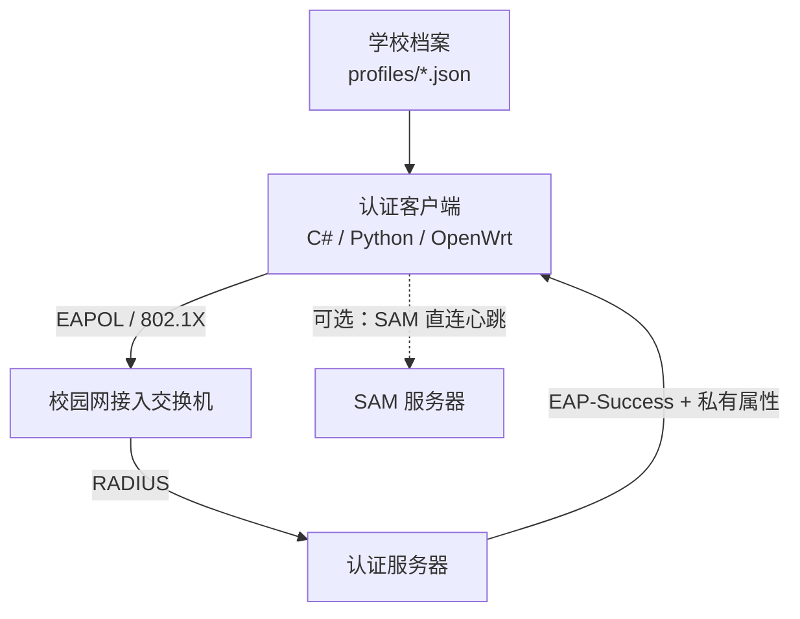

<div align="center">
  <h1>RuijieCampusAuth</h1>
  <p><strong>锐捷校园网 802.1X 认证的跨平台第三方实现</strong></p>
  <p>协议逆向 → 可验证实现 → Windows / Linux / OpenWrt 可部署客户端</p>
  <p>
    
    
    
    
    
    
    
  </p>
</div>

<p align="center">
  🇨🇳 <a href="./README.md">简体中文</a> ·
  🇨🇳 <a href="./README.zh-TW.md">繁體中文</a> ·
  🇺🇸 <a href="./README.en.md">English</a>
</p>

## 目录

- [项目简介](#项目简介)
- [核心能力](#核心能力)
- [快速开始](#快速开始)
- [工作原理](#工作原理)
- [协议覆盖](#协议覆盖)
- [实现矩阵](#实现矩阵)
- [构建与运行](#构建与运行)
- [配置与数据](#配置与数据)
- [验证方法](#验证方法)
- [仓库结构](#仓库结构)
- [文档索引](#文档索引)
- [使用边界](#使用边界)
- [贡献](#贡献)
- [许可证](#许可证)

## 项目简介

RuijieCampusAuth 是锐捷（Ruijie）校园网 802.1X 认证协议的第三方开源实现。项目以锐捷官方 Windows 客户端 `8021x.exe` 的协议行为为参照，提供三套共享同一协议语义与配置模型的实现：

| 形态 | 技术栈 | 运行平台 | 界面 |
|---|---|---|---|
| C# 参考实现 | C# / .NET 10 · Npcap · `SslStream` | Windows | Avalonia GUI、Windows 服务、CLI |
| Python 参考实现 | Python 3.10+ · scapy · `ssl` + `MemoryBIO` | Windows / Linux / macOS | 数字菜单、argparse CLI |
| OpenWrt 实现 | Go 1.25 · AF_PACKET · `crypto/tls` | OpenWrt 24.10（同架构设备；R3G 为实测载体） | LuCI 8 页 |

设计原则是 **协议兼容、行为可验证、学校配置外置**：不修改服务器行为，不绕过认证流程，也不把学校代码、服务名、静态 ID 或服务地址编译进二进制。学校差异通过 `profiles/*.json` 注入，软件本体不写死任何学校参数。

OpenWrt 形态不以 R3G 为限。预编译 ipk 是纯用户态静态 Go 二进制，只要求同架构与版本相近的 OpenWrt；R3G 是目前的主要实测载体，也是我们优先提供定制固件的机型。其他软路由可以直接安装同架构 ipk，后续会补充更多机型固件。

项目只覆盖认证协议与必要的运维能力，不复制官方客户端的界面皮肤、弹窗、公告、托盘、安装器等非协议组件，也不内置任何学校的账号、密码或登录凭据。

**关键词**：IEEE 802.1X · EAP-MD5 · PEAP · MSCHAPv2 · EAPOL · 锐捷私有协议 · OpenWrt · 协议互操作

> [!IMPORTANT]
> 本项目仅用于协议互操作研究与合法网络接入。使用前请确认你对目标校园网具有合法接入权限，并遵守所在学校的管理规定。项目不提供绕过认证、伪造身份或规避审计的能力。

### 版本与发布

| 组件 | 版本 | 发布形态 |
|---|---|---|
| C# 客户端 | 1.0.0 | `RuijieCampusAuth-1.0.0-win-x64.zip`，自包含 .NET 10 |
| OpenWrt 固件 / 插件 | 0.11.4 | 同架构通用的 `ruijie-auth_0.11.4_mipsel_24kc.ipk` + R3G 定制整机固件（实测载体） |
| Python 参考实现 | 随源码 | `pip install -e python` |

最新发布见 [Releases](https://github.com/FairyXH/RuijieCampusAuth/releases/latest)。

## 核心能力

- **协议核心**：EAPOL 组帧、EAP-MD5、569 字节私有尾、服务器私有属性分段解析、PEAP v0/v1 + MSCHAPv2、EAP-TLS。
- **多形态部署**：Windows 上的 Avalonia GUI、Windows 服务与 CLI；跨平台 Python 参考实现；OpenWrt 上的 Go 守护进程 + LuCI。
- **多学校适配**：认证方式、服务名、静态 ID、Portal/自助/升级地址、DHCP 模式等全部由 JSON 档案提供，导入时只覆盖档案声明的字段。
- **可验证实现**：用 Unicorn 直接调用原版二进制算法函数做逐字节差分，用真实服务器接受的抓包做 569 字节尾包与私有属性校验。
- **完整运维面**：账号池、服务器学习与锁定、守护/抢占、重认证调度、DHCP 续租/释放、Portal、诊断、客户端接管与调试管道。
- **OpenWrt 友好**：认证器本体纯用户态，只依赖 AF_PACKET 与 Go 标准库；ipk 不绑定 R3G，同架构、OpenWrt 版本相近即可运行。R3G 是当前实测载体，也是我们优先提供定制固件的机型；WAN 口可自动识别或多选，后续会补充更多机型固件。

## 快速开始

| 场景 | 建议入口 |
|---|---|
| Windows 桌面使用 | 下载 `RuijieCampusAuth-1.0.0-win-x64.zip`，解压后运行 GUI；需要 Npcap 与管理权限 |
| 协议研究 / 脚本 | `cd python && pip install -e . && python -m ruijie_auth` |
| OpenWrt 路由器 | 安装同架构 `ruijie-auth_0.11.4_mipsel_24kc.ipk`；R3G 可直接刷整机固件 |

> [!NOTE]
> Windows 端的二层收发依赖 Npcap。安装 Npcap 时建议勾选 WinPcap 兼容模式；GUI 与服务都需要管理员权限才能打开网卡并修改网络配置。

### 1. Windows（C#）

1. 从 [Releases](https://github.com/FairyXH/RuijieCampusAuth/releases/latest) 下载 `RuijieCampusAuth-1.0.0-win-x64.zip`。
2. 解压到固定目录，运行 `RuijieCampusAuth.App.exe`。
3. 在「配置」页导入学校档案，在「账户」页添加账号，然后启动认证。
4. 需要开机自启时，在「服务」页安装并启动 Windows 服务。

### 2. Python

```bash
cd python
python -m pip install -e .
python -m ruijie_auth          # 数字菜单
ruijie-auth --help             # argparse 子命令
```

Python 版适合协议研究、脚本化和嵌入式场景；二层收发需要 Npcap（Windows）或 libpcap（Linux/macOS）及相应权限。

### 3. OpenWrt

```sh
# 路由器上安装独立插件（保留已有配置）
opkg install --force-reinstall /tmp/ruijie-auth_0.11.4_mipsel_24kc.ipk

# 导入学校档案
ruijie-auth profile import --file "/etc/ruijie-auth/profiles/<学校>.json"

# 查看状态
ruijie-auth status
```

LuCI 入口为「服务 → 锐捷认证器」。`/etc/config/ruijie-auth` 是 conffile，升级插件不会丢失账号、设置与已导入档案。

## 工作原理



<!-- Experimental: if rendering fails, preview this README on GitHub. -->

客户端在链路层发送 EAPOL-Start 与 EAP-Identity，按服务器要求完成 EAP-MD5 或 PEAP/EAP-TLS 握手。锐捷的私有行为主要落在两处：

1. **569 字节私有尾**：附加在 EAPOL 长度字段之外，包含私有头、CRC16/XMODEM、逐字节位反转混淆、属性集与 MD5 链式凭据加密。
2. **服务器私有属性**：EAP-Success 中携带分段结构，包括 GBK 消息段、`0x6F` 固定块、版本门、15 字节解混淆段、TLV 循环与 RC4 字段。

认证成功后，若服务器下发了 SAM 地址与 `ENCRYPT_KEY`/`ENCRYPT_IV`，可选启用 DirComm 直连心跳；心跳连续无响应会触发重新认证。该功能默认关闭，只在 SAM 可达时启用。

## 协议覆盖

| 协议 / 功能 | 实现 | 验证状态 |
|---|---|---|
| EAPOL Start/Logoff、EAP-Identity、EAP-MD5 | C# / Python / OpenWrt | 已实现；私有尾与真实抓包逐字节一致 |
| 569 字节私有尾（私有头、CRC16/XMODEM、位反转混淆、凭据加密、属性集） | C# / Python / OpenWrt | 已实现；原版二进制差分 + 三类真实尾包校验 |
| 服务器私有属性（GBK 消息段、`0x6F` 块、版本门、解混淆段、TLV、RC4） | C# / Python / OpenWrt | 已实现；原版解析器差分 + 真实抓包字段校验 |
| PEAP v0/v1 + MSCHAPv2（MD4、DES、ChallengeHash、NT-Response） | C# / Python / OpenWrt | 已实现；RFC 2759 向量与分片测试；真实 RADIUS 未验证 |
| EAP-TLS | C# / Python / OpenWrt | 协议栈已实现；需要客户端证书，OpenWrt 暂无证书配置入口 |
| DHCP 续租/释放、Option 82 | C# / Python（Windows API） | 已实现；OpenWrt 仅记录 `dhcp_mode`，不驱动 udhcpc |
| Portal / eportal、自助服务、客户端中心、升级检查 | C# / Python | 已实现；升级仅 GET 检查；OpenWrt 未移植 |
| SAM / DirComm 直连心跳 | C# / OpenWrt | 已实现，默认关闭；Python 保留 SAM 探针 |
| 无线 WPA2-Enterprise 档案管理 | C#（Windows WLAN API）/ Python（netsh） | 已实现；需要真实 AP 验证 |
| 诊断（OUI、ARP、代理、拨号、网卡热插拔） | C# / Python | 已实现；OpenWrt 提供 `probe` / `selftest` 子集 |
| 账号池、服务器学习/锁定、守护/抢占、档案导入 | C# / Python / OpenWrt | 已实现 |
| `password-change` / `config-update` 端点 | 未实现 | 缺少协议证据，未做猜测性实现 |

## 实现矩阵

| 能力 | C# | Python | OpenWrt |
|---|---|---|---|
| EAP-MD5 有线认证 | 是 | 是 | 是 |
| 私有尾 / 私有属性 | 是 | 是 | 是 |
| PEAP + MSCHAPv2 | 是 | 是 | 是 |
| EAP-TLS | 是 | 是 | 协议栈是，证书配置否 |
| SAM / DirComm 心跳 | 是（默认关） | 探针 | 是（默认关） |
| GUI | Avalonia | 无 | LuCI |
| Windows 服务 | 是 | 实验性 | 不适用 |
| systemd 服务 | 不适用 | 实验性 | procd |
| DHCP 控制 | Windows API | Windows API | 仅记录 |
| 无线档案 | Windows API | netsh | 未移植 |
| Portal / 自助 / 升级 | 是 | 是 | 未移植 |
| 账号池 | 是 | 是 | 是（最多 5 个） |

## 构建与运行

### C# / .NET

依赖 .NET SDK 10。以下命令均在仓库根目录执行：

```bash
dotnet build RuijieCampusAuth.slnx -c Release
dotnet test RuijieCampusAuth.Core.Tests -c Release
dotnet test RuijieCampusAuth.App.Tests -c Release
dotnet test RuijieCampusAuth.Service.Tests -c Release
powershell -ExecutionPolicy Bypass -File build-csharp.ps1 -Runtime win-x64
```

发布脚本把 Service、CLI 与 GUI 输出到 `publish/<runtime>/`。`Service.Tests` 会占用全局命名管道 `RuijieCampusAuth-Debug`；如果本机服务正在运行，请先停止 `RuijieCampusAuth` 服务再跑该测试。

### Python

```bash
cd python
python -m pip install -e .
python -m ruijie_auth
ruijie-auth --help
PYTHONPATH=src python -m pytest -q
```

### OpenWrt

构建需要 Linux 主机、Go 1.25、Python 3（生成 `.lmo`）以及可选的 OpenWrt Image Builder 24.10。脚本位于 `openwrt/scripts/`：

```sh
cd openwrt
sh scripts/build-go.sh             # 仅编译守护进程
sh scripts/build-ipk.sh            # 生成 ipk（含 LuCI 与中文 .lmo）
sh scripts/fetch-imagebuilder.sh   # 首次构建：下载并校验 Image Builder
sh scripts/build-image.sh          # 生成整机固件（默认 R3G）
```

运行 Go 测试：

```sh
cd openwrt/ruijie-auth
go test ./...
```

插件本体是静态 Go 二进制，使用 AF_PACKET 与标准库，不依赖专属 kmod。目标镜像中的 nftables kmod 来自 LuCI/firewall4 基础系统；帧伪装脚本在缺少 `nft` 时会自动跳过，不影响认证。构建产物默认写入 `openwrt/build/`，不纳入版本控制。

<details>
<summary>OpenWrt 构建产物与刷机提示</summary>

- `build-go.sh` 默认交叉编译 `mipsle`（softfloat），可用 `GOARCH=amd64` 生成 x86_64 版本。
- `build-ipk.sh` 默认产出 `ruijie-auth_<version>_mipsel_24kc.ipk`，可用 `PKG_ARCH` 覆盖架构。
- 整机固件默认面向小米路由器 3G（R3G，MT7621A），它是当前实测载体；ipk 为纯用户态静态二进制，同架构、OpenWrt 版本相近即可使用，不绑定 R3G。其他机型请安装独立 ipk，不要直接刷 R3G 镜像；后续会提供更多机型固件。
- 刷机前先备份原厂分区与 Bootloader。R3G 的 Breed 刷写路径与分区偏移见 `docs/OPENWRT_BUILD_ENV.md` 和 `docs/MANUAL_OPENWRT.md`。

</details>

## 配置与数据

### 学校档案

学校差异统一放在 `profiles/*.json`，每校一份 `<学校>.json`。字段包括认证方式、服务名、静态 ID、Portal/自助/升级地址、DHCP 模式等。仓库附带一份已核对的正式档案，以及若干由安装包生成、待实网确认的候选档案；字段说明、导入方法与切换流程见 [`profiles/README.md`](profiles/README.md)。

C# 与 OpenWrt 使用同一份 schema。导入时只覆盖档案声明的字段，并保留账号与未知配置项；C# 会自动备份 `settings.json.bak-<时间戳>`。

> [!WARNING]
> 校园账号通常只允许一个在线会话。同一账号在多台设备上同时认证会互相顶下线，表现为“认证失败（服务器未返回可读原因）”或会话被静默回收。交叉测试前请先在旧客户端执行 Logoff。

### C# 数据文件

| 文件 | 用途 |
|---|---|
| `accounts.json` | 账号池（DPAPI 保护） |
| `settings.json` | GUI/服务共用设置、档案、调试选项 |
| `service.json` | 服务配置（LocalMachine DPAPI） |
| `discovery.json` | 网卡/服务器发现缓存 |
| `servers.json` | 学习到的认证服务器 |
| `service_status.json` | 服务状态 |
| `takeover_state.json` / `takeover.ini` | 客户端接管状态与心跳 |
| `logs/` | `service.log`、`csharp-gui.log`、`debug.log` |

### OpenWrt 路径

| 路径 | 用途 |
|---|---|
| `/etc/config/ruijie-auth` | UCI 配置与账号（conffile） |
| `/etc/ruijie-auth/profiles/` | 学校档案 |
| `/etc/ruijie-auth/servers.json` | 学习到的认证服务器 |
| `/var/run/ruijie-auth/status.json` | 运行状态 |

### 凭据与日志

- Windows 账号密码使用 DPAPI 保护；OpenWrt 的 UCI 配置权限为 `0600`。
- 调试日志对 password、token、key、IV 等字段脱敏。
- 仓库不包含任何学校账号、密码或登录凭据。

## 验证方法

### 原版二进制差分

`tools/re_diff` 使用 Unicorn 映射原版 `8021x.exe`，按 RVA 直接调用算法函数，与 C#/Python/Go 实现做同输入、同输出比较。已覆盖 CRC16、字节混淆、私有头构建、MD5、凭据加密等函数；调用约定、序号导入与 CRT 字符串布局的差异记录在 [`docs/DIFFERENTIAL_TESTING.md`](docs/DIFFERENTIAL_TESTING.md)。

### 真实抓包向量

使用真实服务器接受的一次认证抓包，提取 EAPOL-Start、Identity、MD5 Response 三类 569 字节私有尾，以及 EAP-Success 中的服务器私有属性块，对实现做逐字节比对：

- 三类私有尾均 **569/569 字节一致**。
- 私有属性块的消息、段 2 值、段 5 hash/interval、全部 10 个 TLV 与 RC4 key/IV 与原版解析器一致。
- Start 使用会话 nonce + 全零 fingerprint；Identity 使用会话 nonce + 随机 fingerprint；MD5 Response 使用随机 nonce/fingerprint 与 challenge IV。

### 单元与集成测试

- **C#**：`RuijieCampusAuth.Core.Tests`、`App.Tests`、`Service.Tests`，覆盖协议向量、档案导入、服务状态与 UI 命令级测试。
- **Python**：`python/tests`，覆盖私有尾、私有属性、RC4、MSCHAPv2、档案、账号存储、菜单与 Guardian。
- **OpenWrt**：`go test ./...`，覆盖协议向量、私有属性、PEAP 分片、状态机、TLS 桥接并发关闭与配置解析。

### OpenWrt 与真机验证

- amd64 与 mipsle 二进制均通过 `ruijie-auth selftest`。
- x86_64 OpenWrt QEMU 中验证守护进程打开 AF_PACKET，并完成 Logoff → Start 重试 → 无服务器暂停的完整生命周期。
- 构建 ipk 与 R3G sysupgrade/Breed 镜像，校验 rootfs 内含守护进程、8 个 LuCI 视图与中文 `.lmo`。
- LuCI 运行时目录按 hash 校验菜单标题与 8 个页面词条，应用自身词条覆盖率 100%。
- R3G（当前实测载体）已刷入并完成真实校园网 EAP-MD5 认证；完整认证循环、Portal 地址学习、服务器私有属性解析与重认证均通过。

### 尚未验证

- [ ] 真实 RADIUS 服务器上的 PEAP / EAP-TLS 端到端握手。
- [ ] EAP-TLS 的客户端证书配置与证书链策略；OpenWrt 尚无证书配置入口。
- [ ] PEAP vendor segment 的完整还原（`0x5F` 凭据段已锁定，其余段仍有未还原函数）。
- [ ] `password-change` / `config-update` 端点（缺少协议证据）。
- [ ] 无线 WPA2-Enterprise 在真实 AP 上的创建与连接。
- [ ] MSCHAPv2 Success 消息中的 `S=` 认证器校验。
- [ ] 更老内核版本与非常规 OpenWrt 定制内核的兼容性。

## 仓库结构

```text
RuijieCampusAuth.Core/        协议、私有尾、解析器、配置、服务安装、接管
RuijieCampusAuth.Service/     Windows 服务宿主（认证循环/日志/调试管道）
RuijieCampusAuth.App/         Avalonia GUI
RuijieCampusAuth.Cli/         命令行（auth/config/service/debug/profile）
RuijieCampusAuth.Core.Tests/  协议与核心逻辑测试
RuijieCampusAuth.App.Tests/   Headless UI 与命令级测试
RuijieCampusAuth.Service.Tests/ 管道集成测试
skills/                       Agent 端到端适配作业手册
tools/re_diff/                Unicorn 直调原版二进制的差分工具
tools/csharp_diff/            C# 侧差分对照器
profiles/                     学校配置档案（每校一份 JSON）
openwrt/                      OpenWrt 插件版源码（Go + LuCI）
python/                       Python 参考实现
docs/                         逆向、协议、适配、构建与操作文档
```

## 文档索引

### 总览与适配

| 文档 | 内容 |
|---|---|
| [docs/AGENT_CONTEXT.md](docs/AGENT_CONTEXT.md) | 跨会话工程上下文、架构要点、已验证状态与已知限制 |
| [docs/OFFICIAL_CLIENT_FEATURE_MATRIX.md](docs/OFFICIAL_CLIENT_FEATURE_MATRIX.md) | 原版客户端功能拆解与 C# 落位矩阵 |
| [docs/ADAPTATION.md](docs/ADAPTATION.md) | 新学校适配规则：逆向 → 档案 → 增量实现 |
| [docs/GENERICIZATION.md](docs/GENERICIZATION.md) | 通用化改造与学校配置外置方案 |
| [profiles/README.md](profiles/README.md) | 学校档案字段、正式档案与导入切换 |

### 实现手册

| 文档 | 内容 |
|---|---|
| [docs/MANUAL_CSHARP.md](docs/MANUAL_CSHARP.md) | C# 版操作手册：安装、GUI、服务、CLI、接管与排错 |
| [docs/MANUAL_PYTHON.md](docs/MANUAL_PYTHON.md) | Python 版操作手册：环境、菜单、CLI、API 与服务 |
| [docs/MANUAL_OPENWRT.md](docs/MANUAL_OPENWRT.md) | OpenWrt 版操作手册：刷机、配置、CLI 与编译 |
| [python/README.md](python/README.md) | Python 实现说明、依赖与模块边界 |
| [openwrt/README.md](openwrt/README.md) | OpenWrt 工程说明、目录结构与设计约束 |

### 协议与逆向

| 文档 | 内容 |
|---|---|
| [docs/REVERSE_ENGINEERING.md](docs/REVERSE_ENGINEERING.md) | 原版客户端逆向总报告：函数地址、调用链与证据 |
| [docs/DIFFERENTIAL_TESTING.md](docs/DIFFERENTIAL_TESTING.md) | Unicorn 直调原版二进制与差分方法、结果 |
| [docs/protocols/README.md](docs/protocols/README.md) | 逐协议档案索引与状态 |
| [docs/protocols/private-properties.md](docs/protocols/private-properties.md) | 服务器私有属性分段格式、TLV 与 RC4 |
| [docs/protocols/peap.md](docs/protocols/peap.md) | PEAP/EAP-TLS、MSCHAPv2 与 vendor segment |
| [docs/protocols/dircomm-heartbeat.md](docs/protocols/dircomm-heartbeat.md) | SAM 直连心跳报文格式与状态机 |
| [docs/protocols/dhcp.md](docs/protocols/dhcp.md) | DHCP 控制与 Option 82 |
| [docs/protocols/portal.md](docs/protocols/portal.md) | Portal/eportal、自助服务与客户端中心 |
| [docs/protocols/sam-upgrade.md](docs/protocols/sam-upgrade.md) | SAM 直通与升级检查 |
| [docs/protocols/wireless.md](docs/protocols/wireless.md) | 无线 WPA2-Enterprise 档案管理 |
| [docs/protocols/diagnostics.md](docs/protocols/diagnostics.md) | OUI、ARP、代理、拨号与网络探测 |

### OpenWrt 专项

| 文档 | 内容 |
|---|---|
| [docs/OPENWRT_PORT.md](docs/OPENWRT_PORT.md) | C# → OpenWrt 移植对照、行为对齐与验证 |
| [docs/OPENWRT_BUILD_ENV.md](docs/OPENWRT_BUILD_ENV.md) | 构建环境、ipk/镜像打包与 Breed 镜像流程 |
| [docs/OPENWRT_FEASIBILITY.md](docs/OPENWRT_FEASIBILITY.md) | OpenWrt 移植可行性评估与 R3G 实测记录 |
| [docs/FIRMWARE_PLUGINS.md](docs/FIRMWARE_PLUGINS.md) | 精简固件预装插件、kmod、更新与构建 |
| [docs/UA3F_VERIFICATION.md](docs/UA3F_VERIFICATION.md) | UA3F/nftables 防检测的报文级实机验证 |
| [docs/MODEL_PORTFOLIO_AUDIT.md](docs/MODEL_PORTFOLIO_AUDIT.md) | 路由器机型覆盖审计、体积分层与优先适配清单 |
| [docs/WAVE1_BUILD.md](docs/WAVE1_BUILD.md) | Wave 1 15 个 mipsel 机型的构建结果与校验 |

### 运维与工具

| 文档 | 内容 |
|---|---|
| [docs/FROZEN_DEPLOYMENT.md](docs/FROZEN_DEPLOYMENT.md) | 部署、升级与运行环境记录 |
| [docs/ROUTER_STABILITY_2026-11-23.md](docs/ROUTER_STABILITY_2026-11-23.md) | R3G 实测：长时间稳定性监测报告 |
| [skills/ruijie-adaptation/SKILL.md](skills/ruijie-adaptation/SKILL.md) | Agent 端到端适配作业手册 |
| [tools/re_diff/README.md](tools/re_diff/README.md) | Unicorn 直调原版函数差分工具的使用 |

## 使用边界

本项目与锐捷网络无隶属或授权关系，仅用于协议互操作研究与合法网络接入。使用者应确保对目标校园网具有合法接入权限，并遵守所在学校的网络管理规定。

项目不提供绕过认证、伪造身份或规避审计的能力。认证失败原因、账号锁定与网络策略均由服务器决定；本项目不修改、不破解、不规避服务器侧的认证与审计逻辑。

## 贡献

欢迎提交 Issue 与 Pull Request，尤其欢迎：

- 新的学校档案与实网核对结果；
- PEAP vendor segment、SAM/DirComm、无线 WPA2-Enterprise 的补充证据；
- OpenWrt 机型适配、构建复现与稳定性报告；
- 文档纠错与协议向量补充。

提交前请先阅读 [`docs/AGENT_CONTEXT.md`](docs/AGENT_CONTEXT.md) 与 [`docs/ADAPTATION.md`](docs/ADAPTATION.md)。涉及协议行为的改动应附带证据（抓包、差分结果或测试向量），并确保 `dotnet test`、`pytest` 或 `go test ./...` 通过。请勿提交账号、密码、含有个人信息的抓包或任何学校内部地址。

## 许可证

本项目采用 MIT 许可证，详见 [LICENSE](LICENSE)。

Copyright (c) 2026 YG
