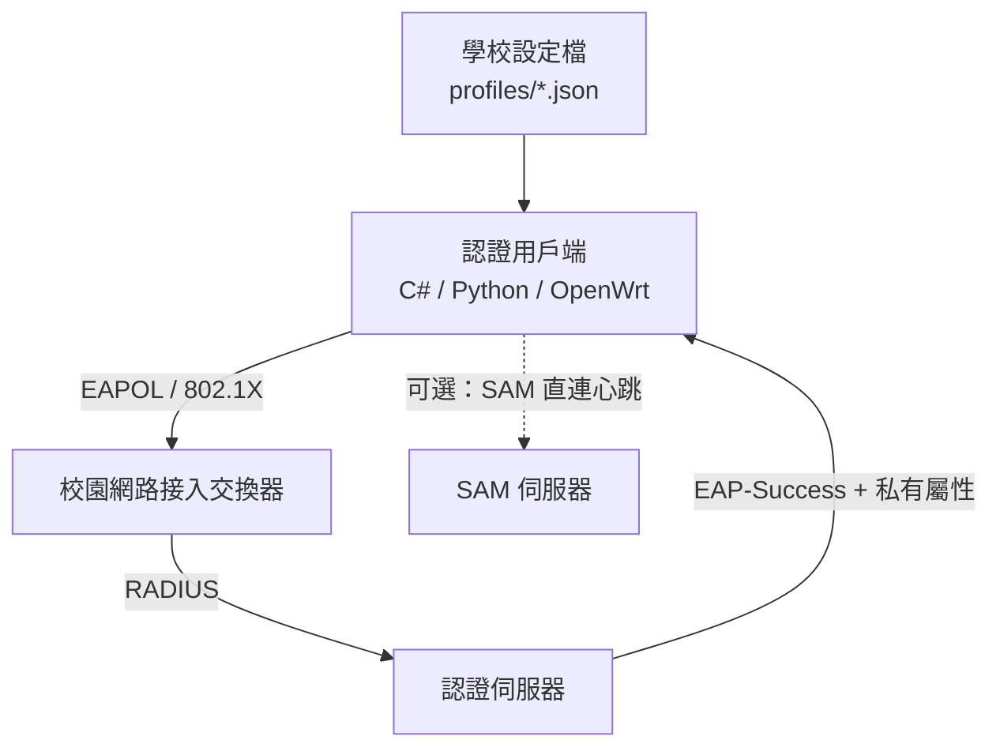

<div align="center">
  <h1>RuijieCampusAuth</h1>
  <p><strong>銳捷校園網路 802.1X 認證的跨平台第三方實作</strong></p>
  <p>協定逆向 → 可驗證實作 → Windows / Linux / OpenWrt 可部署用戶端</p>
  <p>
    
    
    
    
    
    
    
  </p>
</div>

<p align="center">
  🇨🇳 <a href="./README.md">简体中文</a> ·
  🇹🇼 <a href="./README.zh-TW.md">繁體中文</a> ·
  🇺🇸 <a href="./README.en.md">English</a>
</p>

## 目錄

- [專案簡介](#專案簡介)
- [核心能力](#核心能力)
- [快速開始](#快速開始)
- [工作原理](#工作原理)
- [協定覆蓋](#協定覆蓋)
- [實作矩陣](#實作矩陣)
- [建置與執行](#建置與執行)
- [設定與資料](#設定與資料)
- [驗證方法](#驗證方法)
- [儲存庫結構](#儲存庫結構)
- [文件索引](#文件索引)
- [使用邊界](#使用邊界)
- [貢獻](#貢獻)
- [授權條款](#授權條款)

## 專案簡介

RuijieCampusAuth 是銳捷（Ruijie）校園網路 802.1X 認證協定的第三方開源實作。專案以銳捷官方 Windows 用戶端 `8021x.exe` 的協定行為為參照，提供三套共享同一協定語意與設定模型的實作：

| 形態 | 技術堆疊 | 執行平台 | 介面 |
|---|---|---|---|
| C# 參考實作 | C# / .NET 10 · Npcap · `SslStream` | Windows | Avalonia GUI、Windows 服務、CLI |
| Python 參考實作 | Python 3.10+ · scapy · `ssl` + `MemoryBIO` | Windows / Linux / macOS | 數字選單、argparse CLI |
| OpenWrt 實作 | Go 1.25 · AF_PACKET · `crypto/tls` | OpenWrt 24.10 | LuCI 8 頁 |

設計原則是 **協定相容、行為可驗證、學校設定外置**：不修改伺服器行為，不繞過認證流程，也不把學校代碼、服務名、靜態 ID 或服務位址編譯進二進位檔。學校差異透過 `profiles/*.json` 注入，軟體本體不寫死任何學校參數。

專案只涵蓋認證協定與必要的維運能力，不複製官方用戶端的介面面板、彈窗、公告、托盤、安裝器等非協定元件，也不內建任何學校的帳號、密碼或登入認證資訊。

**關鍵詞**：IEEE 802.1X · EAP-MD5 · PEAP · MSCHAPv2 · EAPOL · 銳捷私有協定 · OpenWrt · 協定互通

> [!IMPORTANT]
> 本專案僅用於協定互通研究與合法網路存取。使用前請確認你對目標校園網路具有合法存取權限，並遵守所在學校的網路管理規定。專案不提供繞過認證、偽造身分或規避稽核的能力。

### 版本與發布

| 元件 | 版本 | 發布形態 |
|---|---|---|
| C# 用戶端 | 1.0.0 | `RuijieCampusAuth-1.0.0-win-x64.zip`，自包含 .NET 10 |
| OpenWrt 韌體 / 外掛 | 0.11.4 | R3G 整機韌體 + `ruijie-auth_0.11.4_mipsel_24kc.ipk` |
| Python 參考實作 | 隨原始碼 | `pip install -e python` |

最新發布見 [Releases](https://github.com/FairyXH/RuijieCampusAuth/releases/latest)。

## 核心能力

- **協定核心**：EAPOL 組框、EAP-MD5、569 位元組私有尾、伺服器私有屬性分段解析、PEAP v0/v1 + MSCHAPv2、EAP-TLS。
- **多形態部署**：Windows 上的 Avalonia GUI、Windows 服務與 CLI；跨平台 Python 參考實作；OpenWrt 上的 Go 常駐程式 + LuCI。
- **多學校適配**：認證方式、服務名、靜態 ID、Portal/自助/升級位址、DHCP 模式等全部由 JSON 設定檔提供，匯入時只覆蓋設定檔宣告的欄位。
- **可驗證實作**：用 Unicorn 直接呼叫原版二進位演算法函式做逐位元組差分，用真實伺服器接受的封包擷取做 569 位元組尾包與私有屬性驗證。
- **完整維運面**：帳號池、伺服器學習與鎖定、守護/搶佔、重新認證排程、DHCP 續租/釋放、Portal、診斷、用戶端接管與偵錯管道。
- **OpenWrt 友善**：認證器本體純使用者態，只依賴 AF_PACKET 與 Go 標準庫；不綁定特定機型，WAN 埠可自動辨識或多選。

## 快速開始

| 情境 | 建議入口 |
|---|---|
| Windows 桌面使用 | 下載 `RuijieCampusAuth-1.0.0-win-x64.zip`，解壓後執行 GUI；需要 Npcap 與管理權限 |
| 協定研究 / 指令碼 | `cd python && pip install -e . && python -m ruijie_auth` |
| OpenWrt 路由器 | 安裝 `ruijie-auth_0.11.4_mipsel_24kc.ipk`，或刷入 R3G 整機韌體 |

> [!NOTE]
> Windows 端的第二層收發依賴 Npcap。安裝 Npcap 時建議勾選 WinPcap 相容模式；GUI 與服務都需要管理員權限才能開啟網路卡並修改網路設定。

### 1. Windows（C#）

1. 從 [Releases](https://github.com/FairyXH/RuijieCampusAuth/releases/latest) 下載 `RuijieCampusAuth-1.0.0-win-x64.zip`。
2. 解壓到固定目錄，執行 `RuijieCampusAuth.App.exe`。
3. 在「配置」頁匯入學校設定檔，在「账户」頁新增帳號，然後啟動認證。
4. 需要開機自啟時，在「服务」頁安裝並啟動 Windows 服務。

> [!NOTE]
> 目前 GUI 與 LuCI 均為簡體中文介面，上列頁籤名稱以實際顯示為準。

### 2. Python

```bash
cd python
python -m pip install -e .
python -m ruijie_auth          # 數字選單
ruijie-auth --help             # argparse 子命令
```

Python 版適合協定研究、指令碼化與嵌入式情境；第二層收發需要 Npcap（Windows）或 libpcap（Linux/macOS）及相應權限。

### 3. OpenWrt

```sh
# 路由器上安裝獨立外掛（保留既有設定）
opkg install --force-reinstall /tmp/ruijie-auth_0.11.4_mipsel_24kc.ipk

# 匯入學校設定檔
ruijie-auth profile import --file "/etc/ruijie-auth/profiles/<學校>.json"

# 查看狀態
ruijie-auth status
```

LuCI 入口為「服務 → 锐捷认证器」。`/etc/config/ruijie-auth` 是 conffile，升級外掛不會遺失帳號、設定與已匯入設定檔。

## 工作原理



<!-- Experimental: if rendering fails, preview this README on GitHub. -->

用戶端在連結層傳送 EAPOL-Start 與 EAP-Identity，依伺服器要求完成 EAP-MD5 或 PEAP/EAP-TLS 握手。銳捷的私有行為主要落在兩處：

1. **569 位元組私有尾**：附加在 EAPOL 長度欄位之外，包含私有標頭、CRC16/XMODEM、逐位元組位元反轉混淆、屬性集與 MD5 鏈式認證資訊加密。
2. **伺服器私有屬性**：EAP-Success 中攜帶分段結構，包括 GBK 訊息段、`0x6F` 固定區塊、版本閘門、15 位元組解混淆段、TLV 迴圈與 RC4 欄位。

認證成功後，若伺服器下發了 SAM 位址與 `ENCRYPT_KEY`/`ENCRYPT_IV`，可選擇啟用 DirComm 直連心跳；心跳連續無回應會觸發重新認證。此功能預設關閉，只在 SAM 可達時啟用。

## 協定覆蓋

| 協定 / 功能 | 實作 | 驗證狀態 |
|---|---|---|
| EAPOL Start/Logoff、EAP-Identity、EAP-MD5 | C# / Python / OpenWrt | 已實作；私有尾與真實封包擷取逐位元組一致 |
| 569 位元組私有尾（私有標頭、CRC16/XMODEM、位元反轉混淆、認證資訊加密、屬性集） | C# / Python / OpenWrt | 已實作；原版二進位差分 + 三類真實尾包驗證 |
| 伺服器私有屬性（GBK 訊息段、`0x6F` 區塊、版本閘門、解混淆段、TLV、RC4） | C# / Python / OpenWrt | 已實作；原版解析器差分 + 真實封包擷取欄位驗證 |
| PEAP v0/v1 + MSCHAPv2（MD4、DES、ChallengeHash、NT-Response） | C# / Python / OpenWrt | 已實作；RFC 2759 向量與分片測試；真實 RADIUS 未驗證 |
| EAP-TLS | C# / Python / OpenWrt | 協定堆疊已實作；需要用戶端憑證，OpenWrt 尚無憑證設定入口 |
| DHCP 續租/釋放、Option 82 | C# / Python（Windows API） | 已實作；OpenWrt 僅記錄 `dhcp_mode`，不驅動 udhcpc |
| Portal / eportal、自助服務、用戶端中心、升級檢查 | C# / Python | 已實作；升級僅 GET 檢查；OpenWrt 未移植 |
| SAM / DirComm 直連心跳 | C# / OpenWrt | 已實作，預設關閉；Python 保留 SAM 探針 |
| 無線 WPA2-Enterprise 設定檔管理 | C#（Windows WLAN API）/ Python（netsh） | 已實作；需要真實 AP 驗證 |
| 診斷（OUI、ARP、代理、撥號、網路卡熱插拔） | C# / Python | 已實作；OpenWrt 提供 `probe` / `selftest` 子集 |
| 帳號池、伺服器學習/鎖定、守護/搶佔、設定檔匯入 | C# / Python / OpenWrt | 已實作 |
| `password-change` / `config-update` 端點 | 未實作 | 缺少協定證據，未做猜測性實作 |

## 實作矩陣

| 能力 | C# | Python | OpenWrt |
|---|---|---|---|
| EAP-MD5 有線認證 | 是 | 是 | 是 |
| 私有尾 / 私有屬性 | 是 | 是 | 是 |
| PEAP + MSCHAPv2 | 是 | 是 | 是 |
| EAP-TLS | 是 | 是 | 協定堆疊是，憑證設定否 |
| SAM / DirComm 心跳 | 是（預設關） | 探針 | 是（預設關） |
| GUI | Avalonia | 無 | LuCI |
| Windows 服務 | 是 | 實驗性 | 不適用 |
| systemd 服務 | 不適用 | 實驗性 | procd |
| DHCP 控制 | Windows API | Windows API | 僅記錄 |
| 無線設定檔 | Windows API | netsh | 未移植 |
| Portal / 自助 / 升級 | 是 | 是 | 未移植 |
| 帳號池 | 是 | 是 | 是（最多 5 個） |

## 建置與執行

### C# / .NET

相依 .NET SDK 10。以下命令均在儲存庫根目錄執行：

```bash
dotnet build RuijieCampusAuth.slnx -c Release
dotnet test RuijieCampusAuth.Core.Tests -c Release
dotnet test RuijieCampusAuth.App.Tests -c Release
dotnet test RuijieCampusAuth.Service.Tests -c Release
powershell -ExecutionPolicy Bypass -File build-csharp.ps1 -Runtime win-x64
```

發布指令碼把 Service、CLI 與 GUI 輸出到 `publish/<runtime>/`。`Service.Tests` 會佔用全域具名管道 `RuijieCampusAuth-Debug`；如果本機服務正在執行，請先停止 `RuijieCampusAuth` 服務再跑該測試。

### Python

```bash
cd python
python -m pip install -e .
python -m ruijie_auth
ruijie-auth --help
PYTHONPATH=src python -m pytest -q
```

### OpenWrt

建置需要 Linux 主機、Go 1.25、Python 3（產生 `.lmo`）以及可選的 OpenWrt Image Builder 24.10。指令碼位於 `openwrt/scripts/`：

```sh
cd openwrt
sh scripts/build-go.sh             # 僅編譯常駐程式
sh scripts/build-ipk.sh            # 產生 ipk（含 LuCI 與中文 .lmo）
sh scripts/fetch-imagebuilder.sh   # 首次建置：下載並驗證 Image Builder
sh scripts/build-image.sh          # 產生整機韌體（預設 R3G）
```

執行 Go 測試：

```sh
cd openwrt/ruijie-auth
go test ./...
```

外掛本體是靜態 Go 二進位檔，使用 AF_PACKET 與標準庫，不依賴專屬 kmod。目標映像檔中的 nftables kmod 來自 LuCI/firewall4 基礎系統；訊框偽裝指令碼在缺少 `nft` 時會自動跳過，不影響認證。建置產物預設寫入 `openwrt/build/`，不納入版本控制。

<details>
<summary>OpenWrt 建置產物與刷機提示</summary>

- `build-go.sh` 預設交叉編譯 `mipsle`（softfloat），可用 `GOARCH=amd64` 產生 x86_64 版本。
- `build-ipk.sh` 預設產出 `ruijie-auth_<version>_mipsel_24kc.ipk`，可用 `PKG_ARCH` 覆寫架構。
- 整機韌體預設面向小米路由器 3G（R3G，MT7621A）；其他機型請使用獨立 ipk，不要直接刷 R3G 映像檔。
- 刷機前先備份原廠分割區與 Bootloader。R3G 的 Breed 刷寫路徑與分割區偏移見 `docs/OPENWRT_BUILD_ENV.md` 和 `docs/MANUAL_OPENWRT.md`。

</details>

## 設定與資料

### 學校設定檔

學校差異統一放在 `profiles/*.json`，每校一份 `<學校>.json`。欄位包括認證方式、服務名、靜態 ID、Portal/自助/升級位址、DHCP 模式等。儲存庫附帶一份已核對的正式設定檔，以及若干由安裝套件產生、待實網確認的候選設定檔；欄位說明、匯入方法與切換流程見 [`profiles/README.md`](profiles/README.md)。

C# 與 OpenWrt 使用同一份 schema。匯入時只覆蓋設定檔宣告的欄位，並保留帳號與未知設定項；C# 會自動備份 `settings.json.bak-<時間戳>`。

> [!WARNING]
> 校園帳號通常只允許一個上線工作階段。同一帳號在多台裝置上同時認證會互相擠下線，表現為「認證失敗（伺服器未傳回可讀原因）」或工作階段被無聲回收。交叉測試前請先在舊用戶端執行 Logoff。

### C# 資料檔案

| 檔案 | 用途 |
|---|---|
| `accounts.json` | 帳號池（DPAPI 保護） |
| `settings.json` | GUI/服務共用設定、設定檔、偵錯選項 |
| `service.json` | 服務設定（LocalMachine DPAPI） |
| `discovery.json` | 網路卡/伺服器探索快取 |
| `servers.json` | 學習到的認證伺服器 |
| `service_status.json` | 服務狀態 |
| `takeover_state.json` / `takeover.ini` | 用戶端接管狀態與心跳 |
| `logs/` | `service.log`、`csharp-gui.log`、`debug.log` |

### OpenWrt 路徑

| 路徑 | 用途 |
|---|---|
| `/etc/config/ruijie-auth` | UCI 設定與帳號（conffile） |
| `/etc/ruijie-auth/profiles/` | 學校設定檔 |
| `/etc/ruijie-auth/servers.json` | 學習到的認證伺服器 |
| `/var/run/ruijie-auth/status.json` | 執行狀態 |

### 認證資訊與日誌

- Windows 帳號密碼使用 DPAPI 保護；OpenWrt 的 UCI 設定權限為 `0600`。
- 偵錯日誌會遮蔽 password、token、key、IV 等欄位。
- 儲存庫不包含任何學校帳號、密碼或登入認證資訊。

## 驗證方法

### 原版二進位差分

`tools/re_diff` 使用 Unicorn 映射原版 `8021x.exe`，按 RVA 直接呼叫演算法函式，與 C#/Python/Go 實作做同輸入、同輸出比較。已涵蓋 CRC16、位元組混淆、私有標頭建構、MD5、認證資訊加密等函式；呼叫慣例、序號匯入與 CRT 字串佈局的差異記錄在 [`docs/DIFFERENTIAL_TESTING.md`](docs/DIFFERENTIAL_TESTING.md)。

### 真實封包擷取向量

使用真實伺服器接受的一次認證封包擷取，提取 EAPOL-Start、Identity、MD5 Response 三類 569 位元組私有尾，以及 EAP-Success 中的伺服器私有屬性區塊，對實作做逐位元組比對：

- 三類私有尾均 **569/569 位元組一致**。
- 私有屬性區塊的訊息、段 2 值、段 5 hash/interval、全部 10 個 TLV 與 RC4 key/IV 與原版解析器一致。
- Start 使用工作階段 nonce + 全零 fingerprint；Identity 使用工作階段 nonce + 隨機 fingerprint；MD5 Response 使用隨機 nonce/fingerprint 與 challenge IV。

### 單元與整合測試

- **C#**：`RuijieCampusAuth.Core.Tests`、`App.Tests`、`Service.Tests`，涵蓋協定向量、設定檔匯入、服務狀態與 UI 命令級測試。
- **Python**：`python/tests`，涵蓋私有尾、私有屬性、RC4、MSCHAPv2、設定檔、帳號儲存、選單與 Guardian。
- **OpenWrt**：`go test ./...`，涵蓋協定向量、私有屬性、PEAP 分片、狀態機、TLS 橋接並行關閉與設定解析。

### OpenWrt 與實機驗證

- amd64 與 mipsle 二進位檔均通過 `ruijie-auth selftest`。
- x86_64 OpenWrt QEMU 中驗證常駐程式開啟 AF_PACKET，並完成 Logoff → Start 重試 → 無伺服器暫停的完整生命週期。
- 建置 ipk 與 R3G sysupgrade/Breed 映像檔，驗證 rootfs 內含常駐程式、8 個 LuCI 檢視與中文 `.lmo`。
- LuCI 執行時目錄按 hash 驗證選單標題與 8 個頁面詞條，應用自身詞條覆蓋率 100%。
- R3G 實機已刷入並完成真實校園網路 EAP-MD5 認證；完整認證循環、Portal 位址學習、伺服器私有屬性解析與重新認證均通過。

### 尚未驗證

- [ ] 真實 RADIUS 伺服器上的 PEAP / EAP-TLS 端對端握手。
- [ ] EAP-TLS 的用戶端憑證設定與憑證鏈策略；OpenWrt 尚無憑證設定入口。
- [ ] PEAP vendor segment 的完整還原（`0x5F` 認證資訊段已鎖定，其餘段仍有未還原函式）。
- [ ] `password-change` / `config-update` 端點（缺少協定證據）。
- [ ] 無線 WPA2-Enterprise 在真實 AP 上的建立與連線。
- [ ] MSCHAPv2 Success 訊息中的 `S=` 認證器驗證。
- [ ] 更舊核心版本與非常規 OpenWrt 自訂核心的相容性。

## 儲存庫結構

```text
RuijieCampusAuth.Core/        協定、私有尾、解析器、設定、服務安裝、接管
RuijieCampusAuth.Service/     Windows 服務宿主（認證迴圈/日誌/偵錯管道）
RuijieCampusAuth.App/         Avalonia GUI
RuijieCampusAuth.Cli/         命令列（auth/config/service/debug/profile）
RuijieCampusAuth.Core.Tests/  協定與核心邏輯測試
RuijieCampusAuth.App.Tests/   Headless UI 與命令級測試
RuijieCampusAuth.Service.Tests/ 管道整合測試
skills/                       Agent 端對端適配作業手冊
tools/re_diff/                Unicorn 直呼原版二進位檔的差分工具
tools/csharp_diff/            C# 側差分對照器
profiles/                     學校設定檔（每校一份 JSON）
openwrt/                      OpenWrt 外掛版原始碼（Go + LuCI）
python/                       Python 參考實作
docs/                         逆向、協定、適配、建置與操作文件
```

## 文件索引

### 總覽與適配

| 文件 | 內容 |
|---|---|
| [docs/AGENT_CONTEXT.md](docs/AGENT_CONTEXT.md) | 跨工作階段工程脈絡、架構要點、已驗證狀態與已知限制 |
| [docs/OFFICIAL_CLIENT_FEATURE_MATRIX.md](docs/OFFICIAL_CLIENT_FEATURE_MATRIX.md) | 原版用戶端功能拆解與 C# 對應矩陣 |
| [docs/ADAPTATION.md](docs/ADAPTATION.md) | 新學校適配規則：逆向 → 設定檔 → 增量實作 |
| [docs/GENERICIZATION.md](docs/GENERICIZATION.md) | 通用化改造與學校設定外置方案 |
| [profiles/README.md](profiles/README.md) | 學校設定檔欄位、正式設定檔與匯入切換 |

### 實作手冊

| 文件 | 內容 |
|---|---|
| [docs/MANUAL_CSHARP.md](docs/MANUAL_CSHARP.md) | C# 版操作手冊：安裝、GUI、服務、CLI、接管與排錯 |
| [docs/MANUAL_PYTHON.md](docs/MANUAL_PYTHON.md) | Python 版操作手冊：環境、選單、CLI、API 與服務 |
| [docs/MANUAL_OPENWRT.md](docs/MANUAL_OPENWRT.md) | OpenWrt 版操作手冊：刷機、設定、CLI 與編譯 |
| [python/README.md](python/README.md) | Python 實作說明、相依性與模組邊界 |
| [openwrt/README.md](openwrt/README.md) | OpenWrt 工程說明、目錄結構與設計約束 |

### 協定與逆向

| 文件 | 內容 |
|---|---|
| [docs/REVERSE_ENGINEERING.md](docs/REVERSE_ENGINEERING.md) | 原版用戶端逆向總報告：函式位址、呼叫鏈與證據 |
| [docs/DIFFERENTIAL_TESTING.md](docs/DIFFERENTIAL_TESTING.md) | Unicorn 直呼原版二進位檔與差分方法、結果 |
| [docs/protocols/README.md](docs/protocols/README.md) | 逐協定檔案索引與狀態 |
| [docs/protocols/private-properties.md](docs/protocols/private-properties.md) | 伺服器私有屬性分段格式、TLV 與 RC4 |
| [docs/protocols/peap.md](docs/protocols/peap.md) | PEAP/EAP-TLS、MSCHAPv2 與 vendor segment |
| [docs/protocols/dircomm-heartbeat.md](docs/protocols/dircomm-heartbeat.md) | SAM 直連心跳封包格式與狀態機 |
| [docs/protocols/dhcp.md](docs/protocols/dhcp.md) | DHCP 控制與 Option 82 |
| [docs/protocols/portal.md](docs/protocols/portal.md) | Portal/eportal、自助服務與用戶端中心 |
| [docs/protocols/sam-upgrade.md](docs/protocols/sam-upgrade.md) | SAM 直通與升級檢查 |
| [docs/protocols/wireless.md](docs/protocols/wireless.md) | 無線 WPA2-Enterprise 設定檔管理 |
| [docs/protocols/diagnostics.md](docs/protocols/diagnostics.md) | OUI、ARP、代理、撥號與網路探測 |

### OpenWrt 專項

| 文件 | 內容 |
|---|---|
| [docs/OPENWRT_PORT.md](docs/OPENWRT_PORT.md) | C# → OpenWrt 移植對照、行為對齊與驗證 |
| [docs/OPENWRT_BUILD_ENV.md](docs/OPENWRT_BUILD_ENV.md) | 建置環境、ipk/映像檔打包與 Breed 映像流程 |
| [docs/OPENWRT_FEASIBILITY.md](docs/OPENWRT_FEASIBILITY.md) | OpenWrt 移植可行性評估與 R3G 專項 |
| [docs/FIRMWARE_PLUGINS.md](docs/FIRMWARE_PLUGINS.md) | 精簡韌體預裝外掛、kmod、更新與建置 |
| [docs/UA3F_VERIFICATION.md](docs/UA3F_VERIFICATION.md) | UA3F/nftables 防偵測的封包級實機驗證 |

### 維運與工具

| 文件 | 內容 |
|---|---|
| [docs/FROZEN_DEPLOYMENT.md](docs/FROZEN_DEPLOYMENT.md) | 部署、升級與執行環境記錄 |
| [docs/ROUTER_STABILITY_2026-11-23.md](docs/ROUTER_STABILITY_2026-11-23.md) | R3G 長時間穩定性監測報告 |
| [skills/ruijie-adaptation/SKILL.md](skills/ruijie-adaptation/SKILL.md) | Agent 端對端適配作業手冊 |
| [tools/re_diff/README.md](tools/re_diff/README.md) | Unicorn 直呼原版函式差分工具的使用 |

## 使用邊界

本專案與銳捷網路無隸屬或授權關係，僅用於協定互通研究與合法網路存取。使用者應確保對目標校園網路具有合法存取權限，並遵守所在學校的網路管理規定。

專案不提供繞過認證、偽造身分或規避稽核的能力。認證失敗原因、帳號鎖定與網路策略均由伺服器決定；本專案不修改、不破解、不規避伺服器端的認證與稽核邏輯。

## 貢獻

歡迎提交 Issue 與 Pull Request，尤其歡迎：

- 新的學校設定檔與實網核對結果；
- PEAP vendor segment、SAM/DirComm、無線 WPA2-Enterprise 的補充證據；
- OpenWrt 機型適配、建置重現與穩定性報告；
- 文件糾錯與協定向量補充。

提交前請先閱讀 [`docs/AGENT_CONTEXT.md`](docs/AGENT_CONTEXT.md) 與 [`docs/ADAPTATION.md`](docs/ADAPTATION.md)。涉及協定行為的變更應附帶證據（封包擷取、差分結果或測試向量），並確保 `dotnet test`、`pytest` 或 `go test ./...` 通過。請勿提交帳號、密碼、含有個人資訊的封包擷取或任何學校內部位址。

## 授權條款

本專案採用 MIT 授權條款，詳見 [LICENSE](LICENSE)。

Copyright (c) 2026 YG
